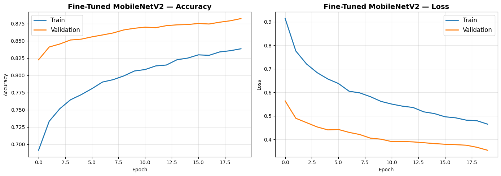
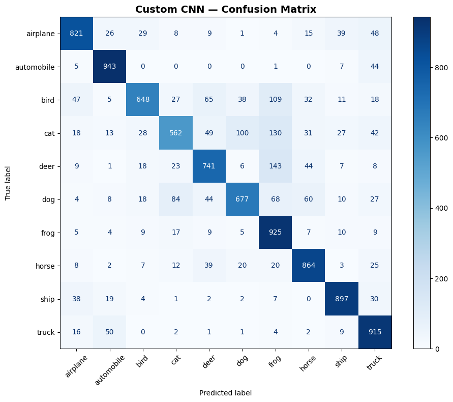
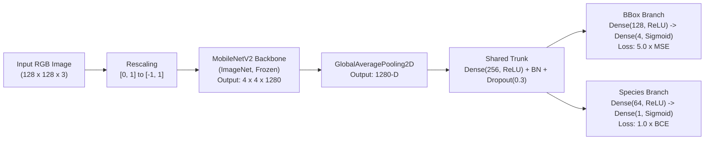
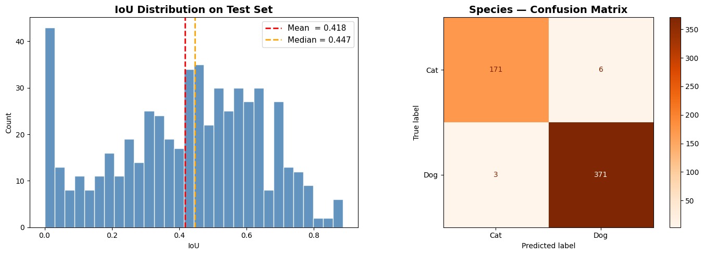
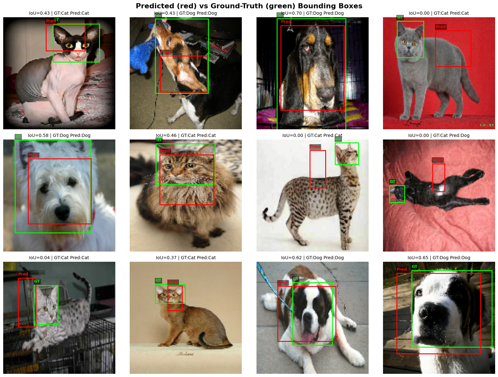

# CIFAR-10 Transfer Learning Benchmark & Multi-Task Pet Head Localization


An end-to-end **Deep Learning & Computer Vision** experimental repository built with **TensorFlow / Keras**. The study investigates two complementary supervised vision pipelines:

1. **Part 1 — Progressive Transfer Learning on CIFAR-10:** Benchmarks a custom 3-stage VGG-style CNN trained from scratch (**`79.93%`**) against an ImageNet-pretrained **MobileNetV2** feature extractor (**`84.19%`**) and a selectively fine-tuned MobileNetV2 (**`88.31%`**).
2. **Part 2 — Multi-Task Pet Localization & Species Recognition (Oxford-IIIT Pet):** Trains a dual-head MobileNetV2 network with a weighted composite objective (`5.0 * MSE + 1.0 * BCE`) to jointly predict binary species labels (**`98.0%`** accuracy) and normalized `[xmin, ymin, xmax, ymax]` head bounding boxes, accompanied by a rigorous **Intersection over Union (IoU)** and **`GlobalAveragePooling2D` spatial bottleneck** analysis.

---

## Experimental Results

### Part 1: CIFAR-10 Multi-Class Classification (`10,000` Official Test Images)

| Model Architecture | Input Size | Backbone State | Trainable Params | Test Loss | Test Accuracy | Macro Precision | Macro Recall | Macro F1 |
| :--- | :---: | :---: | :---: | :---: | :---: | :---: | :---: | :---: |
| **Custom 3-Block VGG CNN** | `32 x 32` | Trained from scratch | `815,530` | `0.5910` | `79.93%` | `0.8049` | `0.7993` | `0.7957` |
| **Frozen MobileNetV2** | `96 x 96` | All 154 layers frozen | `331,018` | `0.4488` | `84.19%` | `0.8415` | `0.8419` | `0.8405` |
| **Fine-Tuned MobileNetV2** | `96 x 96` | Top 30 layers unfrozen (`lr=1e-5`) | `~1.85M` | **`0.3468`** | **`88.31%`** | **`0.8829`** | **`0.8831`** | **`0.8820`** |

#### Convergence & Confusion Matrix Diagnostics



- **Augmentation-Driven Generalization:** Online stochastic `RandomFlip`, `RandomRotation(0.1)`, `RandomZoom(0.1)`, and `RandomTranslation(0.1, 0.1)` combined with `BatchNormalization` and progressive `Dropout` (`0.2 -> 0.5`) keep training accuracy below validation accuracy throughout optimization, eliminating overfitting.
- **Low-Resolution Background-Texture Bias (`frog` Sink Effect):** On native `32x32` patches, the **Custom CNN** exhibits asymmetric false positives toward `frog` (`recall = 0.93`, `precision = 0.66`), with top off-diagonal confusions **`deer -> frog` (`143`)**, **`cat -> frog` (`130`)**, and **`bird -> frog` (`109`)** driven by shared earthy green/brown foliage textures dominating tiny receptive fields. Fine-tuning **MobileNetV2** resolves this shortcut—reducing `deer -> frog` from `143` to `10`, `cat -> frog` from `130` to `41`, and `bird -> frog` from `109` to `29`, raising `frog` precision from `0.66` to `0.91`.



---

### Part 2: Oxford-IIIT Pet Multi-Task Detection (`551` Held-Out Test Images)

#### Dual-Head Network Architecture



#### Quantitative Multi-Task Metrics

| Task / Evaluation Criterion | Metric | Test Result | Notes |
| :--- | :--- | :---: | :--- |
| **Species Classification** | **Accuracy** | **`98.00%`** | `542 / 551` correct (`Cat`: `0.97` F1, `Dog`: `0.99` F1) |
| **Head Localization (Continuous)** | **Mean IoU** | `0.4177` | Average box overlap across held-out test set |
| **Head Localization (Continuous)** | **Median / Std IoU** | `0.4473` / `0.2226` | Half of test predictions exceed `0.447` IoU |
| **Thresholded Detection (`IoU >= 0.30`)** | **Precision / Recall / F1** | **`71.51%`** | Coarse pet head localization succeeds on ~7/10 images |
| **Thresholded Detection (`IoU >= 0.50`)** | **Precision / Recall / F1** | `40.47%` | Standard PASCAL VOC single-object threshold |
| **Thresholded Detection (`IoU >= 0.75`)** | **Precision / Recall / F1** | `4.36%` | Strict high-precision localization regime |



#### Qualitative Bounding-Box Predictions (`Green = Ground Truth`, `Red = Predicted`)



---

## Architectural Analysis: The `GlobalAveragePooling2D` Spatial Bottleneck

Why does the multi-task detector achieve **near-perfect species recognition (`98.0%`)** while achieving **moderate bounding-box precision (`Mean IoU = 0.4177`, `F1@0.50 = 40.47%`)**?

1. **Translation Invariance vs. Coordinate Equivariance:** At `128x128` input resolution, MobileNetV2's final convolutional block produces a `4 x 4 x 1280` tensor encoding coarse spatial quadrants. Passing this tensor through `GlobalAveragePooling2D()` averages activations across all `16` spatial cells into a single `1280`-D vector. While translation invariance is ideal for whole-image classification (`Cat` vs. `Dog`), **collapsing spatial dimensions erases explicit `(x, y)` grid topology**.
2. **Centroid Regression Bias on Off-Center Subjects:** As seen in the qualitative test grid above, close-up portraits where the head fills the central frame achieve strong localization (`IoU = 0.58 – 0.70`). Conversely, on full-body shots where a small head sits near a corner, the spatially pooled representation regresses toward the **animal's body centroid**, yielding near-zero head overlap despite predicting the species accurately.
3. **Pathways to Higher IoU (`> 0.70`):**
   - **Preserve Spatial Feature Grids:** Replace `GlobalAveragePooling2D` on the regression branch with a `1x1 Conv2D` channel Bottleneck (e.g., `1280 -> 128` channels) followed by `Flatten` (`4 x 4 x 128 = 2048`-D) or RoI-style spatial attention so explicit quadrant coordinates reach the bounding-box head.
   - **Overlap-Aware Losses:** Substitute coordinate `MSE` with **GIoU / CIoU** or **Smooth L1 + IoU loss** to directly optimize box overlap regardless of head scale.
   - **Backbone Unfreezing & BBox-Aware Augmentation:** Fine-tune top MobileNetV2 blocks at `lr = 1e-5` alongside synchronized horizontal flip / crop transformations of `[xmin, ymin, xmax, ymax]`.

---

## Repository Structure

```text
multitask-pet-localization-cnn/
├── assets/
│   ├── cifar10_finetuned_training_curves.png    # Accuracy & loss curves for Fine-Tuned MobileNetV2
│   ├── cifar10_custom_cnn_confusion_matrix.png  # CIFAR-10 Custom CNN confusion matrix
│   ├── pet_iou_distribution_and_species_cm.png  # Test IoU histogram & binary species confusion matrix
│   └── pet_bbox_predictions.png                 # Predicted (red) vs. Ground-Truth (green) test overlays
├── notebooks/
│   └── transfer_learning_and_pet_localization.ipynb  # Executed end-to-end Jupyter Notebook with all outputs
├── requirements.txt                             # Python dependencies
├── .gitignore
└── LICENSE                                      # MIT License
```

---

## Reproducing the Experiments

1. **Create a virtual environment and install dependencies:**
   ```bash
   python -m venv .venv
   # Windows:
   .venv\Scripts\activate
   # Linux / macOS:
   source .venv/bin/activate

   pip install -r requirements.txt
   ```

2. **Launch Jupyter Notebook / JupyterLab:**
   ```bash
   jupyter notebook notebooks/transfer_learning_and_pet_localization.ipynb
   ```
   - CIFAR-10 and Oxford-IIIT Pet datasets (along with Pascal VOC head XML annotations) are downloaded automatically on first run.
   - Set `QUICK_RUN = False` (default, GPU recommended) to reproduce the full 50-epoch / 40-epoch benchmark metrics, or `QUICK_RUN = True` for a lightweight CPU smoke run on stratified subsets.

---

## License

Released under the [MIT License](LICENSE). Copyright (c) 2026 Berke Cinkol.
